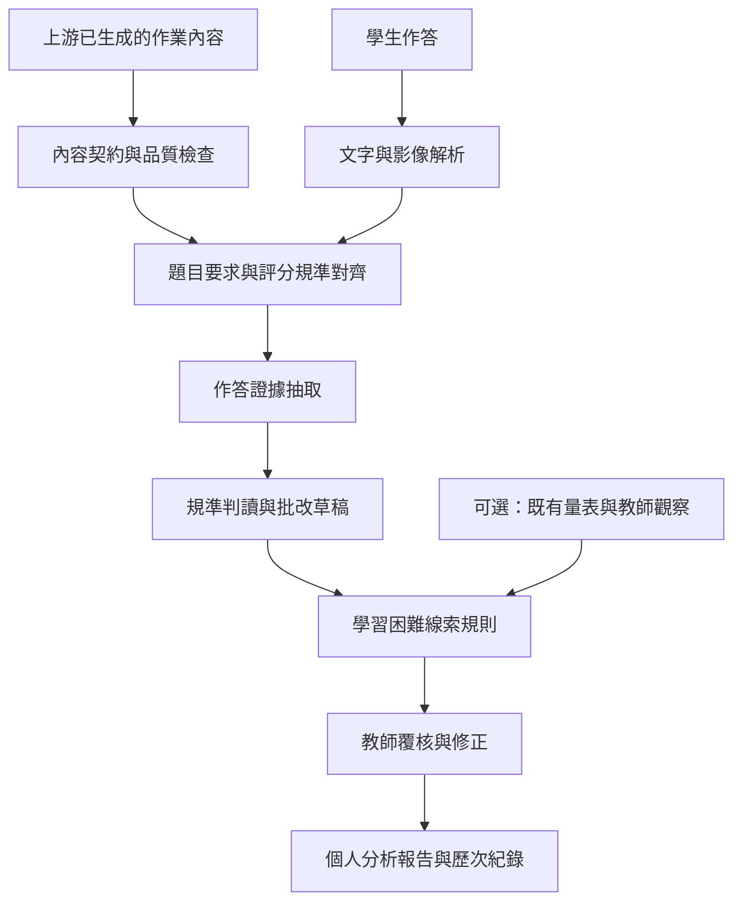

# 國高中社會科作業分析：文獻依據與演算法規劃

更新日期：2026-10-08。狀態：文獻導向的適性化分析演算法設計規格，尚未實作。

## 1. 本次範圍與核心決策

對象為國中與高中學生，以社會組需求為主，第一版分析歷史、地理、公民作業。國中與高中使用各自的年級、教材與評分規準，不能共用能力常模。

本模組接收上游已生成的題目、材料、答案與評分規準，以及學生提交的作答；負責作答分析、批改建議、困難線索整理及教師報告。本模組不出題、不產生補救題、不承擔教材生成。本次不招募學生、不施測、不進行實驗，也不以虛構資料宣稱準確率。

本專題直接引用既有量表背後的理論與構面，不重新研究量表信效度。展示目標是：對同一份作業，依各學生實際作答，產生不同的能力描述、支持需求與回饋重點。

建議採用「文獻構念 → 作答可觀察指標 → 證據抽取 → 規準判讀 → 個人支持需求 → 適性化回饋 → 教師覆核」。先做可解釋的規則系統，不直接訓練學生分類模型。

重要區分：

- 作答評量：學生在這份作業中，實際呈現什麼知識與能力。
- 問卷量表：學生自陳或教師觀察到的動機、策略、信念等。
- 原因假設：可能解釋作答現象的因素，通常不能只憑作業確定。

量表的用途是理論依據，系統輸出稱為「作答表現與支持需求」，而非原量表分數。這個區分不要求本專題額外施測或重做信效度研究，只是準確說明引用與演算法設計的關係。

## 2. 文獻與量表選擇

本次為針對性文獻搜尋，不是系統性文獻回顧。優先使用原始研究、作者提供的論文、研究機構與量表官方資料。各來源的取得程度列於文末。

### 2.1 適合作為分析構念參考的量表

| 文獻／工具 | 研究對象與內容 | 對本系統的用途 | 適用限制 |
|---|---|---|---|
| 劉政宏等（2010），國中小學習動機量表 [R1] | 台灣小六至國三；35題；價值、預期、情感、執行意志。研究含預試與正式樣本共1,417人 | 國中動機面向的本土參考；建立教師需要補充了解的面向 | 沒有作答即可推算量表分數的證據；不能直接當高中常模 |
| Mokhtari & Reichard（2002），MARSI [R2] | 30題閱讀策略自陳量表；定稿研究樣本為443名6–12年級學生；整體閱讀、問題解決、支持性策略 | 將「閱讀時是否監控理解」列為可討論的學習策略；需與實際作答分開 | 自陳策略不等於閱讀理解能力；英文研究不直接建立繁體中文社會科效度 |
| Pintrich & De Groot（1990），動機與自我調整學習研究 [R3] | 173名七年級學生；自我效能、內在價值、考試焦慮、認知策略、自我調整 | 區分「能力表現」與「動機／策略」兩條分析線 | 相關研究不能證明某一錯誤由焦慮或低動機造成；此版本不可與1991年大學生MSLQ手冊混用 |
| Midgley等（2000），PALS [R4] | 官方手冊包含成就目標、學業自我效能、自我設限等學生分量表 | 補充「想精熟內容」與「在意表現」等不同學習目標的概念 | 分量表、年級與語言版本需逐一核對；不能由漏答推斷自我設限；官方設有授權流程 |

優先順序：MARSI作為國中與高中閱讀策略的文獻參考；國中另參考台灣學習動機量表；MSLQ相關研究與PALS補充理論。本專題使用構面，不要求每名學生填問卷。

MARSI-R（Mokhtari等，2018）將題數縮至15題 [R5]。但Ondé等（2022）在570名13–17歲西班牙學生的研究中，發現原先三因素模型配適不足、分量表高度相關 [R6]。因此不能因為量表較短就宣稱跨語言、跨年級皆適用，或直接把三個分量表當作三種獨立能力。

本次只引用構念，不重製完整題目、不自訂原量表切點、不計算學生心理量表分數。高中部分可以引用相關理論作設計參考，但不能稱為已使用台灣高中常模；本次不以建立該常模為目標。

### 2.2 更適合直接分析社會科作答的評量架構

| 來源 | 文獻提供的面向 | 本系統採用方式 |
|---|---|---|
| Wineburg（1991），歷史問題解決研究 [R7]；DIG歷史思考評量 [R8] | 史料來源、時空脈絡、不同材料互證；DIG提供評量規準與作答範例 | 把來源判讀、脈絡化、互證拆成獨立證據欄位；原研究不是台灣學生常模 |
| McGrew等（2018），Civic Online Reasoning [R9] | 中學至大學學生評估網路資訊；關注訊息背後的來源、證據與其他來源的查證 | 公民與跨文本題分別檢查來源、證據及交叉查證；不是政治立場評分 |

社會科開放作答，宜以評分規準（rubric）作為批改核心，問卷量表則提供解釋背景。下列地理與公民的細項規則是本專題提出的操作化設計，不宣稱是上述量表原題或經驗證的新量表。

## 3. 要分析的內容

採用可變動的能力剖面，不把學生固定分成「好／壞」或單一學習類型。每一結論都綁定科目、單元、年級、題目與時間。

| 分析面向 | 可觀察內容 | 適用例子 |
|---|---|---|
| 概念與事實 | 術語意義、事件關係、事實正確性 | 混淆權利／義務、人口數／人口密度 |
| 題意對應 | 是否回應題幹要求的每個部分 | 要比較兩者卻只描述一者 |
| 材料理解 | 是否正確轉述文字、圖表、地圖 | 忽略時間、單位、圖例、限定語 |
| 證據使用 | 主張是否有相關且可定位的證據 | 引用材料但沒有支持該主張 |
| 推理與論證 | 證據如何支持結論、因果是否合理 | 只列原因名稱，沒有解釋作用機制 |
| 來源與脈絡 | 作者、目的、時代、尺度與背景 | 以當代條件直接解釋歷史事件 |
| 比較與多元觀點 | 能否比較材料、辨認限制或處理反方 | 各自摘要兩段資料，未比較異同 |
| 表達與組織 | 段落連貫、指涉清楚、論證順序 | 有相關知識但組織不清楚 |

不是每道題都評所有面向。題目未要求來源判讀時，不因學生沒寫作者而扣分。語文表達與學科概念分開記錄；文章短、文筆不華麗不等於概念錯誤。

正向證據也必須記錄，例如「引用兩份材料並解釋差異」「能指出圖表無法支持因果推論」。不能只產生缺失清單。

## 4. 系統位置與輸入契約



輸入最少包含：

| 欄位 | 說明 | 缺少時的處理 |
|---|---|---|
| assignment_id、content_version | 作業與內容快照識別 | 拒絕建立不可追溯的正式分析 |
| subject、grade、unit | 科目、年級、單元 | 保留未指定，限制跨題彙整 |
| items[].item_id、prompt、response_type | 題目文字、題型、分題結構 | 回報內容不完整，不猜題目 |
| source_materials | 原文、圖表／地圖、頁碼／區塊、出處與版本 | 依賴來源的判讀標記不可評 |
| expected_elements | 必要要點、可接受的替代觀點及支持證據 | 不把單一範文當唯一正解 |
| rubric、rubric_version、review_status | 分項、等級描述、配分、適用能力、審核狀態 | 未審核時僅提供草稿觀察，不能產生正式評分 |
| learner_id、submission_id、attempt_id | 學生代碼、繳交與修訂識別 | 不自行按姓名文字合併學生 |
| response、attachments | 作答與原始附件 | 區分未作答與檔案無法解析 |
| context（選填） | 開卷、限時、可用輔助、已知中斷 | 未提供標記未知，不能推測作答速度 |
| history／scale_results（選填） | 既有作答、教師核准紀錄、實際量表結果及版本 | 沒有就留空，單份作業仍可分析可觀察表現 |

上游內容若只有一份生成的參考答案，不能自動視為正確的評分標準。題幹、材料與答案互相矛盾時，輸出「作業內容待確認」，暫停受影響分項，不將內容錯誤歸給學生。

同一答案由相同模型再次確認，不構成獨立正確性證據。若缺少足夠原始材料，本模組回傳缺件清單，由上游或教師補充，不自行生成新作業。

## 5. 演算法A：結構化作答證據分析

### 5.1 解析與品質檢查

保留原圖、頁碼、文字區塊及OCR位置。文字辨識不清時，對受影響區塊標記needs_review；不能當成學生寫錯。上傳與繳交時間不等於實際作答時間。

題型分流：

- 選擇題：依核准答案與配分規則比對；若上游提供經審核的誘答選項標籤，可輸出該選項對應的可能迷思，不能假裝知道學生選擇原因。
- 短答題：比對必要概念、否定／限定條件與可接受的同義表達。關鍵字只做候選召回，不決定正誤。
- 申論／材料題：抽取主張、證據、推理、限制／反方及來源關係，逐一對照分項規準。
- 圖表／地圖題：先驗證影像可讀與資料位置，再檢查單位、時間、尺度及圖例；看不清時不補猜數值。

### 5.2 證據表示

每個分析紀錄至少包含：

```text
EvidenceFinding {
  item_id, dimension_id, criterion_id,
  observation_code,
  response_span: {page, start, end, quote},
  source_span: {source_id, page, block_id},
  relation: supports | contradicts | not_demonstrated | unresolved,
  candidate_level,
  extraction_status,
  rule_id, rule_version,
  reviewer_status
}
```

quote必須能在實際作答中找到；引用材料也須能定位。自動檢查引文存在只能證明引用位置正確，不能證明語意判斷正確，後者仍需覆核。

「not_demonstrated」表示該作答未展現規準要求，不等於學生永久不會。空白作答的能力狀態是未展現／未知；若學校規則給0分，仍要與能力推論分開儲存。

### 5.3 分項與總分

分項使用上游已核准的等級描述。若將來採0–3級，必須為每個維度分別提供具體描述；不能只有一套模糊的好、中、差。

設第d分項的核准配分為W_d，教師核准等級為r_d，最高等級為L_d：

    分項得分 = W_d × r_d / L_d
    總分 = 所有適用且已完成覆核的分項得分加總

此公式是系統加總規則，不是心理測量模型。存在不可評分項時，總分狀態維持incomplete，同時顯示已完成分項、待確認配分；不可偷偷把缺失項排除後換算成100分。

核心流程：模型抽取與提出判讀草稿 → 程式檢查格式、引文與範圍 → 教師核准分項 → 程式依核准配分加總。問卷分數、特質與姓名不提供給第一階段評分器，以減少預設印象影響評分。

## 6. 演算法B：困難線索與原因假設

規則必須同時定義啟用條件、可觀察證據、反例、替代解釋及結論界線。以下全部是本專題提出的候選規則，尚未建立辨識效度。

| 規則 | 啟用條件與作答現象 | 可輸出的觀察／假設 | 必須保留的替代解釋 | 構念來源 |
|---|---|---|---|---|
| R-COMPLETE | 題目要求多部分，清楚可讀的作答缺少其中一部分 | 本次回應不完整；可能未掌握題意或未完成 | 時間不足、附件遺漏、題幹不清 | 專題操作規則；閱讀策略參考R2 |
| R-CONCEPT | 明確陳述與經核准材料中概念的定義相矛盾 | 本次出現特定概念混淆 | OCR錯誤、口語省略、材料版本差異 | 學科規準；不由動機量表決定 |
| R-EVIDENCE | 題目要求論證，主張缺少相關材料支持 | 證據使用未達規準 | 引用格式不熟、題目未提供足夠材料 | R8、R9 |
| R-REASON | 已有相關證據，但未說明其與結論的關係 | 推理連結未展現 | 字數限制、表達壓縮、題目只要求列點 | 專題論證規則，參考R8 |
| R-SOURCE | 題目明確要求評估來源，僅以外觀或知名度當可信依據 | 來源評估依據不足 | 未提供作者資訊、題目範圍不清 | R9 |
| R-CONTEXT | 解釋史料時使用不適用的年代或背景 | 脈絡化可能有困難 | 題目允許跨時代比較、背景資料不足 | R7、R8 |
| R-CORROBORATE | 要求比較多份材料，卻未處理其相同／矛盾之處 | 跨材料整合未展現 | 題目其實只要求摘錄、材料本身缺漏 | R8、R9 |
| R-GEO | 把不同年份、單位、空間尺度的數值直接相比 | 圖表／地圖資料對齊有誤 | 原圖模糊、資料註記不完整 | 專題地理操作規則，待補專科評量文獻 |
| R-MONITOR | 作答中存在可定位的自相矛盾，尚未修正 | 本次答案仍有未解決矛盾；理解監控可列待了解面向 | 引用不同立場、反諷、省略轉折 | 可觀察規則為專題設計；策略構念參考R2 |
| R-REVISION | 有初稿、回饋、修訂，學生確實修正指定問題 | 本次修訂有改善；可描述回饋採納情形 | 外部協助、改寫但未理解 | 策略構念參考R3；不代表已能獨立遷移 |

禁止直接建立「漏答→懶惰」「低分→動機低」「短答→注意力不足」「錯誤很多→閱讀障礙」的規則。

假設輸出採證據狀態，不採虛構機率：

- observed：可在原作答直接定位的現象，仍標明是否經教師確認。
- hypothesis：從現象提出的可能解釋，附替代原因與所缺資料。
- corroborated_context：既有量表或教師觀察與假設方向一致，但不因此證明因果。
- insufficient：沒有足夠資料判斷；保留空值。

例如：看到多次漏答時，可以描述漏答次數與題目要求；若沒有實際量表與課堂資料，學習動機欄維持unknown。即使有量表結果，也不能將它轉為本次漏答的確定原因。

特質只影響回饋呈現或教師關注面向，不改變同一評分規準。若學生有正式調整措施，將措施明確記在作答情境，不能偷偷調整分數。

### 6.1 適性化的核心：從作答證據選擇支持方式

本系統不必先完成學生人格分類，才能提供適性化。只要同一份作業的不同作答，會觸發不同分析與回饋路徑，就有明確可展示的個別化機制。

| 引用的構面／架構 | 轉成系統可採取的動作 | 需要的作答證據 | 對應輸出 |
|---|---|---|---|
| MARSI：整體閱讀策略 | 檢查題目要求與答案涵蓋範圍 | 題目要求比較，但答案僅敘述一方 | 指出未回應的要求，提供作答結構提示 |
| MARSI：問題解決策略 | 對材料理解與答案矛盾處提供定位 | 明確讀反限定詞或轉述錯誤 | 標出應重新檢視的原材料段落 |
| MARSI：支持性策略 | 對資訊整理不足提供組織方式 | 多項相關資訊散落且未形成比較 | 以既有作答整理成比較框架，不補造答案 |
| MSLQ相關研究：自我調整 | 引導檢查及修訂已識別的問題 | 答案內部矛盾、修訂未處理原缺口 | 提供本次作答的檢查清單與修訂重點 |
| PALS／學習動機：精熟、自我效能、價值等 | 決定回饋語氣與焦點：具體指出已做到的部分，再指出可改善的一步 | 已展現的正向能力與未達成規準 | 給有證據的肯定及可執行回饋；不宣稱學生動機分數 |
| 歷史思考與COR | 區分概念、來源、證據與推理需求 | 來源判讀、材料互證及論證鏈的缺口 | 提供對應能力的說明，而非統一回覆「多讀課本」 |

以上是本專題根據文獻提出的設計映射，不表示原量表包含這些自動規則；也不需要把它重新包裝成一份新心理量表。

### 6.2 適性化決策順序

1. 先處理資料問題：題目或影像不完整，輸出待確認，不建立學生需求判斷。
2. 把每一個經規準支持的缺口映射為支持需求；同一學生可有多個需求，不強制分入單一類型。
3. 用依賴關係排序：若材料理解錯誤導致後續論證錯誤，優先說明材料誤讀；若材料理解正確，再聚焦證據與推理。
4. 為每個需求選取既有回饋模板，填入學生原句、材料位置、規準與改善方向。
5. 保留優勢：每項肯定都引用已展現的能力；缺少正向證據時不編造。
6. 根據輸入中的年級、教師設定及缺口數量調整術語、說明長度與提示細度。這些是明示設定，不是由模型猜測年齡或人格。
7. 沒有明顯缺口且證據完整時，輸出已展現的整合能力，回饋聚焦證據適用範圍與論述限制；不額外產生新題目。

若一項推理缺口只是前面的概念錯誤所造成，兩者建立dependency關係，回饋避免重複責備；是否分項扣分仍只依核准規準決定。

### 6.3 同一份上游作業的展示方式

以下是預期系統行為的示意，不是實驗結果，也不產生新的題目：

| 學生作答特徵 | 分析剖面 | 適性化回饋重點 |
|---|---|---|
| A：能寫出正確概念，引用材料後未連結結論 | 概念已展現；推理連結需要支持 | 指出哪一段證據與主張之間缺少說明 |
| B：文字完整，但把材料中的因果方向讀反 | 表達可理解；材料理解需要支持 | 定位讀反之處，解釋原材料的關係 |
| C：概念與論證完整，能比較來源差異 | 已展現多材料整合能力 | 說明其優勢，指出結論可適用的範圍 |

展示畫面可使用「作答原文 → 文獻構面 → 觸發規則 → 分析結果 → 個人化回饋」五欄，讓觀眾看見每個學生為何得到不同回饋。若日後使用示例資料，需明確標示為示例；本次僅規劃此展示流程。

## 7. 演算法C：跨作業彙整

只有一份作業時，報告限定「本次作答」。多份作業才能描述重複出現的模式，仍不自動診斷原因。

第一版按學生、科目、單元、能力維度、規準版本及作答條件整理：

    某維度達標比例 = 已覆核且達標的可比評量機會數 / 已覆核的可比評量機會數

分母為0時輸出null；同份修訂不能冒充另一個獨立評量機會。顯示分子、分母、作業數、日期範圍與缺失數，不單獨顯示百分比。這是描述性比例，不是「掌握機率」或心理量表分數。

題目難度、支援條件與規準不同時，不把得分變化直接稱為進步或退步；沒有可比題目時，按作業並列展示。歷史因果推理與公民因果論證也先分開，不能直接假設能力完全可遷移。

不同能力可以同時有優勢與困難。例如：「概念定義達標，但證據連結仍不完整」。這比把學生分成優等／落後更能支持教師判讀。

## 8. 演算法選型理由

| 方法 | 適合處理的問題 | 本次決策 |
|---|---|---|
| 規準＋證據抽取＋決策規則 | 各題作答特徵、可追溯批改與多個可能原因 | 第一版主體；不需假裝已有訓練資料 |
| 文本向量相似度／關鍵字 | 尋找候選要點或相關材料 | 只協助檢索；不能單憑與範文相似度評分 |
| BKT，貝氏知識追蹤 [R10] | 根據連續作答更新特定技能的潛在狀態 | 暫不採用；原研究是程序性知識，社會科複合申論還需技能定義、觀測轉換與參數依據 |
| DINA，認知診斷模型 [R11] | 題目對應多技能，以Q矩陣表示技能需求 | 暫不採用；需合理Q矩陣、足夠作答資料與模型估計，不能現在捏造能力機率 |
| 端到端學生類型分類 | 將學生直接分群或分類 | 本次不採用；缺少標註與可驗證的分類意義 |

LLM的角色為受約束的作答解析器與判讀草稿產生器；它的自報信心值不當成校準過的正確率。所有規則都保存文獻來源或標記為專題設計。

## 9. 主流程偽程式碼

```text
analyze(package, submission, optional_history, optional_context):
    verify ownership, ids, versions and input completeness
    validate prompt/material/rubric consistency
    if contract is invalid:
        return input_issue_report

    parsed = parse_response_with_original_locations(submission)
    findings = []
    for item in package.items:
        if item material or response region is unreadable:
            findings += unresolved_item(item)
            continue
        requirements = get_reviewed_requirements(item)
        if requirements are not reviewed:
            findings += observation_only(item)
            continue
        candidates = extract_claims_evidence_reasoning(parsed, item)
        candidates = verify_quotes_and_locations(candidates)
        draft = match_candidates_to_rubric(candidates, requirements)
        findings += validate_allowed_levels_and_explanations(draft)

    observations = apply_versioned_rules(findings, package.task_demands)
    hypotheses = attach_alternatives_and_missing_evidence(observations)
    hypotheses = add_existing_context_without_changing_scores(
        hypotheses, optional_context)
    support_needs = map_findings_to_support_needs(observations)
    priorities = order_by_prerequisite_dependencies(support_needs)
    feedback = select_feedback_templates(priorities, strengths=findings,
                                        grade=package.grade)
    report = compose_evidence_linked_draft(findings, hypotheses, feedback)
    save_draft_and_provenance(report)
    return report_for_teacher_review

on_teacher_review(report, decisions):
    save_immutable_review_decisions(decisions)
    compute_score_only_from_approved_criteria()
    rebuild_descriptive_summary_from_comparable_approved_attempts()
    return reviewed_report
```

此為設計偽程式碼，不是已完成的程式。沒有執行模型、學生施測或效果實驗。

## 10. 報告呈現

每位學生的報告固定分四部分：

1. 本次已展現的能力：附題號、原句與規準。
2. 需要加強的作答面向：描述具體缺口，不使用人格評價。
3. 可能原因與替代解釋：明示哪些是推測、缺少哪些資料。
4. 評量界線：未考察的能力、辨識不清區塊、未審核內容。

示意分析紀錄（說明格式，非真實學生資料、非新生成題目）：

```json
{
  "scope": "本次公民材料題",
  "strength": "已提出清楚主張",
  "observed_issue": "引用材料後，未說明材料如何支持主張",
  "dimension": "evidence_reasoning_link",
  "status": "draft_requires_review",
  "possible_explanations": ["論證連結尚未寫出", "表達過度省略"],
  "alternative_explanations": ["題目字數限制", "評分規準要求不清楚"],
  "motivation_score": null,
  "reading_strategy_scale_score": null,
  "cause_probability": null
}
```

實際紀錄還必須包含作答與來源位置，這個示意沒有學生原文，因此不能當成已完成分析證據。

## 11. 對現有系統的接入規劃

已閱讀專案README、FEATURE_ROADMAP.md與shared/schema.sql。現有系統為FastAPI、PHP班級管理、SQLite與本機Ollama；已具有教材版本與學生資料表，但上述schema尚未包含作業分析所需資料表。

建議在FastAPI新增分析模組，沿用班級權限與教材版本資訊；PHP仍提供既有班級資料。這裡只有規劃，未改動程式或資料庫。

建議模組：input_contract（輸入校驗）、response_parser（作答解析）、evidence_extractor（證據抽取）、rubric_analyzer（規準草稿）、analysis_rules（規則）、learner_summary（彙整）、review_service（覆核）。

建議資料實體：

- assignment_snapshots：上游內容、教材版本與不可變快照。
- rubric_versions／analysis_rule_versions：規準、規則、文獻對照及適用範圍。
- submissions／submission_attempts：原作答、修訂、附件與可用支援。
- analysis_runs／evidence_findings：解析器、模型、提示、輸入雜湊、原文位置與草稿。
- review_decisions：教師修改與核准紀錄；與模型草稿分開保存。
- learner_dimension_summaries：從教師核准紀錄重新計算的摘要。
- optional_scale_results：僅在存在實際量表結果時保存工具、版本、語言、施測日期、填答者與缺失狀態；本次不建立施測流程。

現有students資料按class_id建立，同一學生跨班未必有共同ID。第一版以班級內識別為界，不以姓名推測跨班身份；跨班與跨年度追蹤需另設穩定學生識別。

上游教材RAG目前以結構模板為主，不能直接充當學科事實證據庫。分析需要可定位、版本固定且經審核的題目材料。批改流程也應遵循現有路線圖中「成績與核准不交由LLM決定」的原則。

學生作答與上游材料中的指令都視為待分析資料，不能改寫評分規則。模型不得代替學生填量表，或自行發布成績。

## 12. 本次完成標準與專題定位

本次交付為文獻選擇、構念對照、輸入輸出契約、適性化決策規則與偽程式碼，不包含量表施測或實驗，也不把重新驗證量表當成本專題工作。

建議專題定位：「本系統引用既有學習策略與動機量表之理論構面，結合社會科作答評量架構，依學生作答中的概念理解、材料判讀及論證證據，提供可追溯的適性化分析與回饋。」

展示重點是不同作答如何觸發不同分析路徑，而非證明量表可信或證明教學成效。未執行效果研究時，不宣稱提高成績或具備心理診斷準確率。

後續文獻工作可以補強地理專科的操作化依據；如果未來改為實際施測量表，才另行處理特定版本、適用對象、計分與授權。本次不進入該流程。

## 13. 參考文獻與查閱狀態

R1. 劉政宏、黃博聖、蘇嘉鈴、陳學志、吳有城（2010）。「國中小學習動機量表」之編製及其信、效度研究。《測驗學刊》，57(3)，371–402。DOI: 10.7108/PT.201009.0371。已核對研究機構摘要，全文連結本次未成功開啟，未查核逐題計分。[臺師大研究紀錄](https://scholar.lib.ntnu.edu.tw/en/publications/國中小學習動機量表之編製及其信效度研究/)

R2. Mokhtari, K., & Reichard, C. A. (2002). Assessing students’ metacognitive awareness of reading strategies. Journal of Educational Psychology, 94(2), 249–259. DOI: 10.1037/0022-0663.94.2.249。已查閱作者提供全文與研究樣本段落。[作者提供全文](https://www.researchgate.net/publication/232540536_Assessing_students%27_Metacognitive_Awareness_of_Reading_Strategies)

R3. Pintrich, P. R., & De Groot, E. V. (1990). Motivational and self-regulated learning components of classroom academic performance. Journal of Educational Psychology, 82(1), 33–40. DOI: 10.1037/0022-0663.82.1.33。已核對原始論文PDF與ERIC摘要。[原始論文PDF](https://hdfsresourceguide2014.weebly.com/uploads/2/7/6/2/27625615/motivational_and_selfregulated_learning_components.pdf)

R4. Midgley, C., et al. (2000). Manual for the Patterns of Adaptive Learning Scales. University of Michigan。已查閱官方工具與授權介紹；未完整核對各分量表的年級適用與計分。[官方手冊入口](https://public.websites.umich.edu/~pals/manuals.html)

R5. Mokhtari, K., Dimitrov, D. M., & Reichard, C. A. (2018). Revising the Metacognitive Awareness of Reading Strategies Inventory (MARSI) and testing for factorial invariance. Studies in Second Language Learning and Teaching, 8(2), 219–246。已查閱期刊摘要。[期刊原頁](https://doi.org/10.14746/ssllt.2018.8.2.3)

R6. Ondé, D., Jiménez, V., Alvarado, J. M., & Gràcia, M. (2022). Analysis of the Structural Validity of the Reduced Version of Metacognitive Awareness of Reading Strategies Inventory. Frontiers in Psychology。已查閱全文摘要、樣本與模型結果。[期刊全文](https://doi.org/10.3389/fpsyg.2022.894327)

R7. Wineburg, S. S. (1991). Historical problem solving: A study of the cognitive processes used in the evaluation of documentary and pictorial evidence. Journal of Educational Psychology, 83(1), 73–87. DOI: 10.1037/0022-0663.83.1.73。已核對研究摘要；規準面向另交叉參照研究團隊官方資料R8。[研究摘要](https://eric.ed.gov/?id=EJ436869)

R8. Digital Inquiry Group. History Assessments / Beyond the Bubble。已查閱研究團隊官方評量介紹與能力分類；未下載或重製題目。[官方評量架構](https://www.inquirygroup.org/history-assessments)

R9. McGrew, S., Breakstone, J., Ortega, T., Smith, M., & Wineburg, S. (2018). Can Students Evaluate Online Sources? Learning From Assessments of Civic Online Reasoning. Theory & Research in Social Education, 46(2), 165–193. DOI: 10.1080/00933104.2017.1416320。已核對原研究摘要與作者群的公開說明，期刊全文受存取限制。[研究摘要](https://eric.ed.gov/?id=EJ1179994)；[作者群公開說明](https://www.aft.org/ae/fall2017/mcgrew_ortega_breakstone_wineburg)

R10. Corbett, A. T., & Anderson, J. R. (1995). Knowledge tracing: Modeling the acquisition of procedural knowledge. User Modeling and User-Adapted Interaction, 4, 253–278。已核對出版者摘要與原研究情境。[出版者頁面](https://doi.org/10.1007/BF01099821)

R11. de la Torre, J. (2009). DINA Model and Parameter Estimation: A Didactic. Journal of Educational and Behavioral Statistics, 34(1), 115–130。已核對出版者書目與模型介紹；本次不實作參數估計。[出版者頁面](https://doi.org/10.3102/1076998607309474)

版本區分補充：Pintrich等（1991）的MSLQ手冊明確以大學課程為對象，不能直接作為台灣國高中生量表適用性的依據。[原手冊書目與摘要](https://eric.ed.gov/?id=ED338122)
