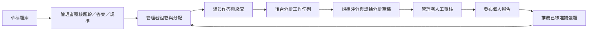
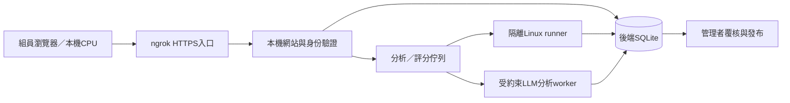

# LLM 互動評量網站：獨立系統規劃 v0.1

日期：2026-10-12。對象：懂基本 Python、初學 LLM 的專案組員。

## 1. 已確認的需求

- 第一階段獨立於現有專案，未來再整合。
- 以 ZJU-LLMs《大模型基礎》第 1、2 章為範圍；題目由 Codex 產出。
- 所有持久資料儲存於後端資料庫，包含題目、答案、規準、分析規則、分配、作答、分析與覆核紀錄。
- 管理者自行組卷、搭配題型、分配組員、核准題目及覆核分析。
- 以檢測理解為主要目的，互動形式服務於可觀察的作答證據。
- 延續 `teacher-workspace-demo-package/app/docs/HOMEWORK_ANALYSIS_LITERATURE_AND_ALGORITHM.md` 的可解釋分析架構。本次不是沿用社會科常模，而是另建 LLM 學科的題目規準。

本次提供規劃和後端草稿題庫，尚未完成網站、排程服務或真實組員分析。資料庫不包含虛構的組員作答或效果數據。

## 2. 教材基準

來源：https://github.com/ZJU-LLMs/Foundations-of-LLMs

使用工作區的中文分章 PDF；中文文字抽取存在字型編碼錯置，另參照同庫英文版本的 ch1、ch2 查核概念與小節。題目以本地來源快照為基準，不把教材的歷史型號比較當成今日性能排名。來源路徑及 SHA-256 儲存於資料庫。

| 小節 | 核心檢測 | 互動設計 |
|---|---|---|
| 1.1 統計語言模型 | 條件機率、n-gram、資料稀疏 | 次數表計算、公式拼圖、bigram 實作 |
| 1.2 RNN | 隱藏狀態、序列依賴、訓練／生成差異 | 遞迴流程排序、短答、teacher forcing 配對 |
| 1.3 Transformer | Q/K/V、遮罩、注意力、平行性 | 流程拼圖、遮罩操作、小矩陣計算 |
| 1.4 採樣 | greedy、beam、top-k、top-p、temperature | 搜尋樹、候選集合操作、top-p 實作 |
| 1.5 評測 | perplexity、內部／外部評測、比較條件 | 數值計算、評測情境、PPL 實作 |
| 2.1 規模與能力 | 資料／參數／算力權衡、能力觀察界線 | 資料表判讀、資源分配、條件短答 |
| 2.2 架構概覽 | encoder-only、encoder-decoder、decoder-only | 架構分類、注意力配對、選型論證 |
| 2.3 Encoder-only | BERT、MLM、雙向上下文 | 遮罩預測、任務配對、概念辨錯 |
| 2.4 Encoder-decoder | T5、BART、cross-attention | Q/K/V 來源拼圖、去噪任務、輸入／輸出分流 |
| 2.5 Decoder-only | 自回歸、因果遮罩、訓練目標 | next-token 配對、遮罩操作、目標位移實作 |
| 2.6 非 Transformer | SSM、Mamba、TTT 的基本區別 | 狀態更新計算、機制配對、比較界線 |

平滑、矩陣實作等練習是為檢測教材概念設計的延伸活動，題庫另標記 extension；不要求初學者從零訓練大型模型。

## 3. 網站使用流程與頁面

| 頁面 | 內容與操作 |
|---|---|
| 組員首頁 | 已分配任務、期限、練習／正式檢測標記、已發布報告 |
| 作答工作台 | 題幹、材料、互動區、必要解釋欄、儲存狀態、題目導覽 |
| 實作工作台 | Python 編輯區、固定函式介面、公開測試、輸出、繳交 |
| 個人報告 | 已展現能力、缺口、引用證據、補強方向、待評範圍 |
| 管理者題庫 | 小節／技能／題型／難度篩選、題目版本、答案、規準、試做與覆核 |
| 組卷／分配 | 選題、配分、順序、分題時間建議、組員、期限、輔助條件、發布時機 |
| 分析後台 | 工作狀態、題別證據、分項草稿、觸發規則、替代解釋、模型版本 |
| 覆核工作台 | 原作答與規準並排、逐項核准／修改／退回、註記、發布報告 |
| 團隊概覽 | 每個技能的可比達標次數、分母、未評數、常見缺口；可點回原證據 |

視覺方向：繁體中文、深藍配青綠、清楚的題目卡與狀態標籤。首頁重點是任務與覆核，不以排行榜為主。拖曳題提供點選及鍵盤操作；色彩之外另顯示文字與符號。

練習模式可顯示提示及公開測試；正式檢測的提示、查教材、AI 使用及回饋時間由管理者設定。提示後答對與首次獨立答對分開顯示。作答時間只描述已記錄的有效操作範圍，不以停留時間推斷動機。

## 4. 題型與出題契約

每題先定義檢測目標，再決定互動形式。

| 題型 | 必要證據 | 批改路徑 |
|---|---|---|
| 選擇／配對 | 選項 ID、理由（需要時） | 核准答案規則比對；理由另評 |
| 短答／論證 | 主張、條件、具體例子／計算 | 模型抽取原文，分項規準草稿，人工覆核 |
| 拼圖／排序 | 最終結構、關鍵位置、必要理由 | 合法結構或依賴關係校驗；不只比對唯一字串 |
| 遮罩／圖表操作 | 每格設定、數值、操作前預測 | 決定性比對＋解釋規準 |
| 參數實驗 | 預測、參數、可重現輸出、解釋 | 區分預測與操作後觀察；使用固定資料與 seed |
| Python 實作 | 程式、測試結果、說明、使用的支援 | 隔離執行、公開／隱藏測試、人工覆核 |

每題需保存：教材來源、小節、技能標籤、先備技能、難度設計值、題幹、材料、UI payload、答案／等價答案、必要證據、分項規準、可能迷思、提示、測試案例、內容版本、覆核狀態。難度是出題設計值，日後有資料才另估實際作答表現。

初始草稿題庫：41 題，包括每個小節 3 題的基礎／互動／實作題（共 33 題），另有 8 題案例解讀與改善方案題，其中 5 題為 Python 實作。不表示已完成教育效度驗證。管理者可從中搭配約 60–75 分鐘的檢測：基礎問答 4 題、結構互動 3 題、案例改善 1 題、實作 1 題。實際時間需先試做再調整。

核心目標是檢測案例理解及提出下一步改善的判斷力。案例為他人的教材／論文研究，不稱為組員自己做過的實驗。每道改善題包含五個作答欄：結果解讀、問題與替代解釋、改善方案及機制、驗證設計、成本與失敗判準。規準分別評案例理解、問題辨識、機制可行性、驗證、取捨，不以新名詞多寡或文筆判分。

合理改善可有多種；評估方案是否由來源證據支持、是否針對問題、是否可執行，以及能否被實驗否定。案例題即使讀對數字，如果只說「增加資料／換更大模型」而未連結原因與驗證，改善及驗證分項仍未達標。

目前已直接核對兩個原始論文案例：BERT Table 5 的 SQuAD dev F1 消融結果，以及 Chinchilla §4.2.1 的 WikiText-103 PPL 與污染限制。其數值節錄、URL、表號／小節與 hash 存入資料庫。其餘案例為教材概念延伸；教學假設明確標示，沒有捏造論文實驗數據。

原始案例來源：[BERT 原論文](https://aclanthology.org/N19-1423.pdf)、[Chinchilla 原論文 v1](https://arxiv.org/html/2203.15556v1)。

正式卷保留共同核心題，才能比較組員；個人補強題放在練習或後測。不同難度／提示条件的成績並列呈現，不直接以總分比較。

## 5. 延續個人化作業分析：後台演算法

### A. 規準與作答證據分析

1. 檢查已核准題目、規準版本、材料完整性及任務快照。
2. 依題型分流：決定性規則、數值容差、合法排列、測試程式或文字證據抽取。
3. 將 evidence 定位到文字區段、程式行號、互動格子或測試紀錄。
4. 依本題適用維度提出分項判讀；LLM 只提供受約束草稿。
5. 程式檢查引文存在、等級合法、配分上限、必備欄位與依賴關係。
6. 管理者覆核，程式依核准等級計分，再發布報告。

維度：概念正確性、題意完整性、資料／數值判讀、機制推理、比較與限制、實作正確性、驗證與解釋。每題只啟用必要維度。表達華麗與否不作為概念分數依據。

分項得分 = 本題分項配分 × 核准等級 / 最高等級。不可評或尚未覆核的分項維持 incomplete，不自行重算為百分制。空白可按組卷規則給 0 分，但能力證據狀態記為 not_demonstrated。

### B. 困難線索與支持需求

| 候選規則 | 必要條件與可定位證據 | 回饋方向 |
|---|---|---|
| LLM-CONCEPT | 明確主張與本題核准概念相矛盾 | 定位矛盾，回看對应小節 |
| LLM-COMPLETE | 題幹明確要求比較或解释，答案缺少其中一部分 | 顯示漏掉的要求 |
| LLM-CONDITION | PPL 比較忽略 tokenizer 等條件，或選型忽略限制 | 補上判斷成立的條件 |
| LLM-REASON | 結果正確但未呈現題目要求的推理 | 指出缺少的連結，另給遷移題 |
| LLM-FORMULA | 次數、分母或維度使用錯誤且可核對 | 先整理輸入與符號，再重算 |
| LLM-IMPLEMENT | 概念解釋符合規準，程式測試出現具體邊界錯誤 | 指定失敗案例，要求修訂 |
| LLM-MONITOR | 同一答案出現未處理的矛盾 | 要求對照前後主張 |
| LLM-REVISION | 修訂確實處理原缺口 | 記錄改善，另測獨立遷移 |

上述是專題設計規則。保留題幹含糊、操作失誤、支援條件、程式環境、表達省略等替代解釋。一次誘答選擇只作線索，不直接宣布學生持有穩定迷思；不由低分推斷動機、人格或心理量表分數。

### C. 個人剖面與跨次彙整

按技能、規準版本、難度及支援條件分組：達標比例 = 已覆核達標機會 / 已覆核可比機會。分母為 0 回傳 null；顯示分子、分母、日期、獨立評量次數和缺失數。修訂、重跑同題與同題變數變體不可灌成多個獨立證據。

同時呈現「概念已展現、機制解釋待補、程式邊界失敗」等多維結果。短期資料少時顯示證據不足，不顯示虚構的掌握機率。先不實作 BKT、DINA 或 IRT 參數估計，延續原規劃的可解釋規則主體。

### D. 出題與推薦

出題模組與分析模組分開。Codex 產生草稿題目與規準，管理者核准後才進入可分配題池；分析器本身不偷偷生成補救题。

推薦流程：讀取已覆核缺口 → 先備技能優先 → 篩選已核准且未曝光題目 → 依技能符合度、難度設計、題型互補和曝光紀錄排序 → 保存推薦原因 → 管理者選擇搭配與分配。此排序是透明啟發規則，不是已經訓練的自適應測驗模型。

### E. 背景執行

繳交只建立任務及不可變輸入快照，回傳工作 ID。獨立 worker 從資料庫領取工作；状态 queued → running → draft_ready / failed，超時可重試。重試使用唯一輸入雜湊與分析器版本防止重複結果。重新分析建立新 run，不覆蓋已覆核成績。

模型輸入只提供本題材料、規準、作答；姓名和過往分數不提供給初次評分器。作答中的指令視為資料。若模型 unavailable，客觀題仍產生規則草稿，文字題標記待分析。公開結果只來自管理者批准的發布版本。

## 6. 後端與資料庫

實作建議：獨立 Python API、SQLite、背景 worker、可選本機 LLM。瀏覽器採用互動元件，答案與隱藏測試不傳往作答端。這是架構選擇，框架版本需在實作時確認。

本次 `llm-assessment/backend/assessment.sqlite3` 是規劃用初始資料庫，表結構保存於建置腳本；包含來源快照、11 個技能、41 道版本化草稿題、8 條規則與本文件。其餘實體先建立空表，網站階段再補完整欄位驗證、索引與 migration。

核心實體：users、learners、sources、skills、questions、question_versions、analysis_rules、assignments、assignment_items、assignment_recipients、submissions、attempts、responses、interaction_events、analysis_jobs、analysis_runs、evidence_findings、review_decisions、published_reports、recommendations、documents。

題目 ID 穩定，修改建立版本；組卷固定引用版本。規準、答案和 source hash 也固定。組員 ID 使用獨立 UUID，未來整合以明確 mapping 對應專案 ID，不用姓名推測身份。

前台只取得已分配題目公開內容。答案、迷思標籤、隱藏測試與分析規則只在後端及管理介面。分析草稿、人工修改、最終分數分開存；題目核准不等於成績核准。

建議 API：題庫草稿建立／版本覆核、assignment 組卷／分配、response 自動儲存、submission 繳交、analysis job 狀態、review decisions、report 發布、recommendations 核准、匯出／匯入。每個入口驗證管理者或收件人權限。

Python 執行需要獨立受限 runner，限制時間、記憶體、網路與檔案權限；不在網站主程序直接 eval/exec 組員程式。第一版先用小資料純 Python 題，無 GPU 依賴。

未來整合採 API 與有版本的資料匯出包，包括 skills、question_versions、rubrics、assignment snapshots、responses、review decisions。保留 UUID／來源／規則版本映射；登入再接專案 SSO。

## 7. 題庫覆核清單與驗收

題目發布前：核對教材版本、正解與同義解、必要證據、題型可操作性、實作函式契約、測試案例與容差、難度合理性、分項描述、提示效果及無障礙操作。題干與答案矛盾則退回，不當成組員錯誤。

網站完成前至少驗證：

1. 未核准題目不能分配；任務發布後保持題目快照。
2. 組員不能讀取他人作答或後端答案。
3. 同一客觀答案重跑結果一致；不完整題目輸出待確認。
4. 文字證據能回指實際原句；虛構引用被拒絕。
5. 拼圖接受合法等價結構；觸控／鍵盤可作答。
6. 程式超時／失敗不影響主網站；公開與隱藏測試分開。
7. 模型草稿不自動發布；人工修改保存原始結果與修改理由。
8. 個人摘要可追溯到已覆核題目，不混用練習／正式／修訂證據。
9. 工作重試不重複計分；匯出／匯入能保留版本與 ID。

## 8. 實作階段

- P0：完成本規劃與草稿題庫，管理者審題。
- P1：題庫管理、組卷、分配、組員登入、問答／拼圖作答、人工覆核和發布報告。
- P2：背景分析工作、證據規則、個人剖面與可解釋推薦。
- P3：操作實驗、受限 Python runner、跨次可比分析。
- P4：資料匯出 API、專案身份對應與整合。

「後台演算法」納入 P2；不能只有展示圖表而沒有保存證據與覆核鏈。第一個端到端驗收場景：同一題不同作答 → 不同可定位缺口 → 不同回饋草稿 → 管理者核准 → 個人報告及補強題建議。

## 9. 免費執行環境與 ngrok 部署

以下為 2026-10-12 查閱官方資料後的選型規劃，尚未安裝或對外啟動服務。

| 路徑 | 裝置與用途 | 費用及限制 |
|---|---|---|
| 首選：Pyodide + Web Worker | 文書機瀏覽器直接練習純 Python／小型數值題；不需 GPU 或安裝 Python | 開源，自己托管靜態資源無軟體授權費；WebAssembly 套件相容性需實測，不能視為完整 Linux／CUDA |
| 選用：本機 Python venv | 題目需原生套件時，組員先安裝固定依賴 | 不依賴付費服務；提供 Windows／Linux 安裝說明、診斷與範例試跑；不預設人人有 CUDA |
| 正式評分：主機隔離 Linux runner | 在你電腦的 Linux VM／受限容器執行公開及隱藏測試 | 自行托管開源 runtime，無第三方 API 費；仍有本機硬體／電力成本與資源限制 |
| 多語言備選：Judge0 自行托管 | 若後續要 C/C++ 等編譯題，提供統一編譯與執行 API | GPLv3 開源，自己托管；不假設公共 API 永久免費、無額度或可供多人正式使用 |

[Pyodide 官方文件](https://pyodide.org/en/stable/)說明其為瀏覽器中的 Python／WebAssembly 環境；[Judge0 原始碼與授權](https://github.com/judge0/judge0)提供自行托管的多語言隔離執行方案。Python 題此階段主要需求是執行與測試，不必先加入 C/C++ 編譯。

瀏覽器 runner 只供練習，其測試回傳不能當不可竄改的正式證據。正式繳交上傳程式碼，後端重跑；隱藏測試只留在後端。瀏覽器 worker 不取得登入 token 或後端秘密，隔離執行頁使用獨立來源／sandbox，透過狹窄訊息介面送出程式與輸出，不在主頁 JS 同權限直接執行。

Linux command 操作以「題目專屬工作目錄＋允許的工具」提供。若要終端題，使用短生命週期、非 root、無網路、無主機掛載、資源受限的環境。不要讓組員透過網頁進入你個人電腦的任意 shell，也不要把 Docker socket、資料庫或 Ollama 管理介面暴露給作答者。

網站部署在你電腦，ngrok 只負責對外通道，不承擔資料庫與程式執行。前端和 API 儘量同來源，僅一個網站 port 進入通道；worker／runner 僅內部可達。

[ngrok 免費方案官方限制](https://ngrok.com/docs/pricing-limits/free-plan-limits)目前包含指定的 dev domain，HTML 瀏覽通常有首次提示頁，並有用量與併發限制；實作及施測前按官方儀表板確認當期額度。不能承諾所有組員任意頻率長期使用都免費可行。

部署順序：本地端到端驗收 → Linux runner 隔離驗收 → 小組局域網試用 → 設定 ngrok 通道 → 測試外網登入、檔案大小、併發排隊及斷線恢復。管理者帳戶與作答者分權，密鑰用本機環境設定，成績與題庫不置於靜態 public 目錄。

純 Python 題的設計目標為每題短時間、低記憶體；正式數值上限需以你主機測試後固定。較重的 LLM 研究用閱讀公開實驗結果、縮小樣本或預先計算特徵設計題目，不要求文書機重現數十億參數訓練。需要 GPU 的擴展任務由管理者決定，與分析 worker 分開排程。

## 10. 人工覆核的重點範例

BERT 題：先確認組員能讀對 Table 5；再看是否識別「同時改動多個因素」造成的歸因限制；最後判斷其下一步實驗是否控制變因，而非只堆模型。

Chinchilla 題：先讀懂 PPL 下降；再辨認資料污染及訓練設定差異；最後檢查是否提出去污染測試或受控比較，以及成功／失敗怎麼判斷。

報告不輸出「有 sense／沒有 sense」的固定標籤，而是給具體證據：能辨認限制、方案對應原因、驗證有基準，或缺少控制變因／沒有資源估計。一次作答代表本次表現；重複可比案例才支持較穩定的描述。
